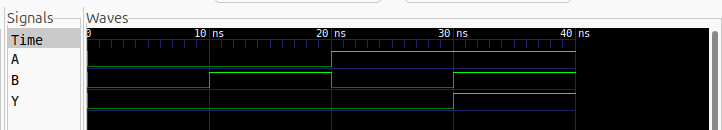

# Aula 01 — Porta lógica AND em Verilog

## 1. Objetivo

Descrever uma porta lógica **AND** de duas entradas usando Verilog HDL, simular todas as combinações binárias com **Icarus Verilog**, verificar automaticamente a saída com um *testbench* e interpretar as formas de onda no **GTKWave**.

> **Resultado observado no computador Linux:** os quatro casos de teste passaram, e o GTKWave exibiu a saída `Y` em nível alto apenas quando `A = 1` e `B = 1`.

## 2. Fundamentos da porta AND

A operação lógica AND (E) gera nível alto somente quando **ambas** as entradas estão em nível alto:

\[
Y = A \land B
\]

Em Verilog, utiliza-se o operador `&` para o AND bit a bit. Como os sinais desta aula têm um único bit, `assign Y = A & B;` descreve a porta AND.

### Tabela-verdade

| A | B | Y = A & B |
|:-:|:-:|:-:|
| 0 | 0 | 0 |
| 0 | 1 | 0 |
| 1 | 0 | 0 |
| 1 | 1 | 1 |

## 3. Código Verilog — `porta_and.v`

Código do circuito: [`porta_and.v`](porta_and.v).

```verilog
module porta_and (
    input  wire A,
    input  wire B,
    output wire Y
);
    assign Y = A & B;
endmodule
```

- `module porta_and`: define o circuito.
- `input wire A` e `input wire B`: entradas binárias.
- `output wire Y`: saída binária.
- `assign Y = A & B;`: atribuição contínua; qualquer mudança em `A` ou `B` atualiza `Y` na simulação lógica.

O circuito é **combinacional**: não contém relógio (*clock*) nem armazenamento de estado.

## 4. Testbench — `tb_porta_and.v`

O [testbench](tb_porta_and.v) instancia o módulo `porta_and` como `dut` (*design under test*) e aplica quatro vetores de teste, cada um mantido por `#10` (10 ns, considerando ``timescale 1ns/1ps` no testbench).

A cada vetor, o valor medido de `Y` é comparado ao valor esperado usando `!==`, que também detecta estados indeterminados (`X`) ou de alta impedância (`Z`).

As chamadas `$dumpfile("ondas.vcd")` e `$dumpvars(0, tb_porta_and)` geram o arquivo **VCD** (*Value Change Dump*), usado para visualizar as formas de onda.

Se algum teste falhar, `$fatal(1)` encerra a simulação com erro. Caso contrário, o testbench imprime `PASS`.

## 5. Ambiente e reprodução

Ferramentas utilizadas: **Linux**, **VS Code**, **Icarus Verilog** (`iverilog` e `vvp`) e **GTKWave**.

No Ubuntu/Debian, instale os programas:

```bash
sudo apt update
sudo apt install iverilog gtkwave make
```

Na **raiz do repositório**, execute:

```bash
make test
make wave
```

- `make test` compila os arquivos Verilog e executa o testbench.
- `make wave` repete a simulação e abre o GTKWave.
- `make clean` remove os arquivos temporários.

## 6. Saída da simulação no terminal

Na execução registrada da Aula 01, a saída foi:

```text
OK: A=0 B=0 | Y=0
OK: A=0 B=1 | Y=0
OK: A=1 B=0 | Y=0
OK: A=1 B=1 | Y=1
PASS: 4 de 4 combinacoes verificadas.
```

**Interpretação:** foram verificadas todas as quatro combinações possíveis para duas entradas de um bit; nenhuma divergência foi detectada.

> Na execução inicial, o compilador emitiu um aviso de `timescale` para `porta_and.v`. Esse aviso não invalidou o teste. Para uniformizar as unidades de tempo, pode-se adicionar a diretiva ``timescale 1ns/1ps` no início do módulo, tal como já ocorre no testbench.

## 7. Resultado gráfico — GTKWave



*Figura 1 — Recorte da captura real do GTKWave enviada durante a execução da Aula 01, mostrando os sinais A, B e Y.*

### Interpretação temporal

| Intervalo de tempo | A | B | Y | Interpretação |
|:--|:-:|:-:|:-:|:--|
| 0–10 ns | 0 | 0 | 0 | Ambas as entradas em nível baixo. |
| 10–20 ns | 0 | 1 | 0 | Apenas B em nível alto. |
| 20–30 ns | 1 | 0 | 0 | Apenas A em nível alto. |
| 30–40 ns | 1 | 1 | 1 | Ambas em nível alto; saída passa para 1. |

O sinal `Y` permanece em zero até **30 ns**, instante em que `A` e `B` tornam-se simultaneamente iguais a 1. Esta resposta confirma a tabela-verdade da porta AND.

**Observação:** esta simulação funcional não demonstra atrasos físicos de propagação. Os tempos indicam os instantes dos estímulos do testbench.

## 8. Arquivos da aula

| Arquivo | Finalidade |
|:--|:--|
| [`porta_and.v`](porta_and.v) | Circuito AND descrito em Verilog |
| [`tb_porta_and.v`](tb_porta_and.v) | Testbench e geração do VCD |
| [`porta_and_gtkwave.png`](porta_and_gtkwave.png) | Evidência visual da simulação |
| `ondas.vcd` | Arquivo gerado localmente pela simulação; ignorado pelo Git |

## 9. Conclusão

A porta AND foi implementada e validada no Linux. **Quatro de quatro casos passaram**, e a forma de onda apresentou o comportamento lógico esperado.

**Próxima aula:** porta OR, aplicando o mesmo procedimento de implementação, simulação, documentação e validação.
