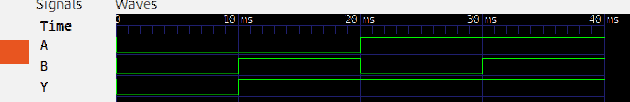

# Aula 02 — Porta lógica OR em Verilog

## 1. Objetivo

Nesta aula, implementamos uma **porta lógica OR (OU) de duas entradas** em Verilog HDL e construímos um **testbench** para verificar automaticamente todas as combinações possíveis de `A` e `B`.

Ao concluir o exercício, devemos compreender:

- a diferença entre a descrição do circuito e o código de teste;
- as declarações `module`, `input`, `output`, `wire` e `reg`;
- a atribuição contínua com `assign` e o operador OR (`|`);
- a instanciação do circuito sob teste (*DUT — Design Under Test*);
- o uso de `initial`, `task`, `#10`, `if` e operadores de comparação;
- a geração de um arquivo VCD para visualização no GTKWave.

> **Estado do exercício:** os valores apresentados como saída de simulação e forma de onda são **resultados esperados**. O teste efetivo deve ser executado no computador e registrado após sua confirmação.

## 2. Fundamentação teórica

A porta OR gera saída lógica `1` quando **pelo menos uma entrada** está em nível alto. Sua expressão booleana é:

\[
Y = A \lor B
\]

Na álgebra booleana, a mesma função pode ser representada como `Y = A + B`, em que `+` denota OR lógico, **não** uma soma aritmética convencional.

### 2.1. Tabela-verdade

| A | B | Y = A OR B |
|:-:|:-:|:----------:|
| 0 | 0 | 0 |
| 0 | 1 | 1 |
| 1 | 0 | 1 |
| 1 | 1 | 1 |

**Comparação com a Aula 01:** a porta AND (`A & B`) só gera `1` se **ambas** as entradas forem `1`. Na OR (`A | B`), basta **uma** entrada igual a `1`.

## 3. Código do circuito — `porta_or.v`

O arquivo [`porta_or.v`](porta_or.v) descreve o hardware a ser simulado e, posteriormente, poderia ser utilizado em uma etapa de síntese digital.

```verilog
`timescale 1ns/1ps

// Exercicio 02: porta logica OR de duas entradas.
// Saida Y = 1 quando A = 1 ou B = 1.
module porta_or (
    input  wire A,
    input  wire B,
    output wire Y
);
    assign Y = A | B;
endmodule
```

### 3.1. Entendendo cada elemento

| Trecho | Significado |
|:--|:--|
| `` `timescale 1ns/1ps `` | Define unidade de tempo de `1 ns` e precisão de `1 ps` para esse módulo na simulação. |
| `module porta_or (...)` | Inicia a definição de um módulo chamado `porta_or`. |
| `input wire A` | Declara `A` como entrada de um bit, representada por uma rede (*net*). |
| `input wire B` | Declara `B` como segunda entrada de um bit. |
| `output wire Y` | Declara `Y` como saída de um bit. |
| `assign Y = A \| B;` | Calcula continuamente a operação OR **bit a bit** entre as entradas. |
| `endmodule` | Encerra o módulo. |

O operador `|` é o **OR bit a bit** do Verilog. Para os sinais de um único bit usados nesta aula, ele implementa diretamente a função da porta OR. Não confundir com `||`, que é um operador de **OR lógico** frequentemente empregado em condições.

A declaração `assign` especifica uma ligação combinacional: quando `A` ou `B` mudam, a expressão é reavaliada, sem necessidade de um clock. O código **não contém memória, registradores de estado nem atrasos físicos modelados**.

## 4. Código de teste — `tb_porta_or.v`

O arquivo [`tb_porta_or.v`](tb_porta_or.v) **não descreve a porta física**. Ele monta um ambiente de simulação, aplica entradas ao circuito e verifica se a resposta corresponde à tabela-verdade.

```verilog
`timescale 1ns/1ps

// Testbench da porta OR: verifica todas as combinacoes de entrada.
module tb_porta_or;
    reg A;
    reg B;
    wire Y;
    integer erros;

    // Dispositivo sob teste (DUT).
    porta_or dut (
        .A(A),
        .B(B),
        .Y(Y)
    );

    // Aplica um vetor de entrada e compara com o resultado esperado.
    task verificar;
        input a_teste;
        input b_teste;
        input y_esperado;
        begin
            A = a_teste;
            B = b_teste;
            #10;
            if (Y !== y_esperado) begin
                $display("FALHA: A=%b B=%b | Y=%b (esperado=%b)",
                         A, B, Y, y_esperado);
                erros = erros + 1;
            end else begin
                $display("OK: A=%b B=%b | Y=%b", A, B, Y);
            end
        end
    endtask

    initial begin
        $dumpfile("ondas_or.vcd");
        $dumpvars(0, tb_porta_or);
        erros = 0;

        verificar(1'b0, 1'b0, 1'b0);
        verificar(1'b0, 1'b1, 1'b1);
        verificar(1'b1, 1'b0, 1'b1);
        verificar(1'b1, 1'b1, 1'b1);

        if (erros != 0) begin
            $display("FALHA: %0d teste(s) incorreto(s).", erros);
            $fatal(1);
        end

        $display("PASS: 4 de 4 combinacoes verificadas.");
        $finish;
    end
endmodule
```

### 4.1. Declaração dos sinais

```verilog
reg A;
reg B;
wire Y;
integer erros;
```

- `reg A` e `reg B`: variáveis dirigidas pelos comandos procedurais do testbench. **`reg` não significa necessariamente um flip-flop**; aqui serve para guardar os valores atribuídos durante a simulação.
- `wire Y`: recebe a saída produzida pelo módulo `porta_or`.
- `integer erros`: conta quantas verificações falharam.

### 4.2. Instanciação do circuito

```verilog
porta_or dut (
    .A(A),
    .B(B),
    .Y(Y)
);
```

- `porta_or` é o **nome do tipo de módulo** definido no arquivo do circuito.
- `dut` é o **nome desta instância específica** (*Design Under Test*).
- `.A(A)` conecta a porta de entrada `A` do módulo ao sinal `A` do testbench; `.B(B)` e `.Y(Y)` seguem a mesma regra.

Essa conexão permite que o testbench envie estímulos ao circuito e observe sua saída.

### 4.3. A tarefa `verificar`

```verilog
task verificar;
    input a_teste;
    input b_teste;
    input y_esperado;
    begin
        A = a_teste;
        B = b_teste;
        #10;
        if (Y !== y_esperado) begin
            // Registra a falha e aumenta o contador.
        end else begin
            // Registra que o teste passou.
        end
    end
endtask
```

A `task` agrupa uma sequência reutilizável de operações de teste. Cada chamada a `verificar(...)` realiza o seguinte:

1. Atribui valores às duas entradas do circuito.
2. Aguarda `#10`: com a escala `1ns/1ps`, o estímulo permanece por **10 ns simulados**.
3. Compara `Y` com o resultado esperado.
4. Imprime `OK` ou `FALHA` e atualiza o contador de erros, quando necessário.

O operador `!==` é uma comparação de desigualdade que considera também os estados `X` (desconhecido) e `Z` (alta impedância). Isso é útil no teste porque uma saída indefinida **não deve passar como se fosse válida**.

### 4.4. Bloco `initial` e aplicação dos vetores

```verilog
initial begin
    $dumpfile("ondas_or.vcd");
    $dumpvars(0, tb_porta_or);
    erros = 0;

    verificar(1'b0, 1'b0, 1'b0);
    verificar(1'b0, 1'b1, 1'b1);
    verificar(1'b1, 1'b0, 1'b1);
    verificar(1'b1, 1'b1, 1'b1);

    // Avalia o contador de erros, informa o resultado e encerra.
end
```

O bloco `initial` começa uma vez no início da simulação. Aqui, ele executa as quatro chamadas a `verificar` em sequência.

A constante `1'b0` significa **valor binário de 1 bit igual a 0**. Analogamente, `1'b1` significa 1 bit igual a 1.

| Chamada | A | B | Saída esperada | Período simulado |
|:--|:-:|:-:|:-:|:--|
| `verificar(1'b0, 1'b0, 1'b0)` | 0 | 0 | 0 | 0–10 ns |
| `verificar(1'b0, 1'b1, 1'b1)` | 0 | 1 | 1 | 10–20 ns |
| `verificar(1'b1, 1'b0, 1'b1)` | 1 | 0 | 1 | 20–30 ns |
| `verificar(1'b1, 1'b1, 1'b1)` | 1 | 1 | 1 | 30–40 ns |

Ao final, se `erros != 0`, a chamada `$fatal(1)` encerra a simulação com condição de falha. Quando nenhum erro é contabilizado, `$display` imprime a mensagem `PASS` e `$finish` encerra normalmente a execução.

### 4.5. Arquivo de formas de onda

```verilog
$dumpfile("ondas_or.vcd");
$dumpvars(0, tb_porta_or);
```

- `$dumpfile` escolhe o nome do arquivo **VCD** (*Value Change Dump*).
- `$dumpvars(0, tb_porta_or)` solicita o registro das alterações dos sinais associados à hierarquia do testbench.

**Importante:** o arquivo `ondas_or.vcd` é criado no **diretório de trabalho do terminal**, e não necessariamente na mesma pasta do `.v`. Por isso, os comandos desta documentação partem da pasta `02_OR`.

## 5. Executar no Linux

Requisitos: **Icarus Verilog**, **GTKWave** e um terminal (pode ser o terminal integrado do VS Code).

### 5.1. A partir da pasta `02_OR`

No terminal, entre na pasta que contém `porta_or.v` e `tb_porta_or.v`. Confirme:

```bash
pwd
ls
```

Deverão aparecer os dois arquivos `.v`. Em seguida, execute:

```bash
mkdir -p build
iverilog -Wall -s tb_porta_or -o build/porta_or.vvp porta_or.v tb_porta_or.v
vvp build/porta_or.vvp
```

O que cada comando faz:

| Comando ou opção | Papel |
|:--|:--|
| `mkdir -p build` | Cria uma pasta para o executável da simulação, se necessário. |
| `iverilog` | Compila o circuito e o testbench. |
| `-Wall` | Ativa avisos úteis do compilador. |
| `-s tb_porta_or` | Define o módulo principal (*top level*) da simulação. |
| `-o build/porta_or.vvp` | Define o destino do programa de simulação compilado. |
| `vvp build/porta_or.vvp` | Executa a simulação compilada. |

### 5.2. Alternativa: a partir da raiz do repositório

Se o terminal estiver em `verilog-fundamentos-fpga/`, use os caminhos completos, relativos **à raiz**:

```bash
mkdir -p build
iverilog -Wall -s tb_porta_or -o build/porta_or.vvp \
  01_Portas_Logicas/02_OR/porta_or.v \
  01_Portas_Logicas/02_OR/tb_porta_or.v
vvp build/porta_or.vvp
```

**Erro frequente:** se o terminal já estiver em `02_OR/`, **não** prefixe os nomes dos arquivos com `01_Portas_Logicas/02_OR/`. Isso faria o compilador procurar um caminho inexistente.

## 6. Saída esperada no terminal

Após uma compilação e simulação bem-sucedidas, esperamos obter:

```text
VCD info: dumpfile ondas_or.vcd opened for output.
OK: A=0 B=0 | Y=0
OK: A=0 B=1 | Y=1
OK: A=1 B=0 | Y=1
OK: A=1 B=1 | Y=1
PASS: 4 de 4 combinacoes verificadas.
```

A mensagem `PASS` comprovará, **quando observada na execução real**, que os quatro vetores testados produziram os resultados esperados. A simulação funcional verifica a lógica descrita, mas **não mede atrasos físicos reais de propagação ou utilização de recursos na FPGA**.

## 7. Interpretar o GTKWave

Se a simulação foi executada a partir de `02_OR/`, abra o arquivo VCD com:

```bash
gtkwave ondas_or.vcd
```

No GTKWave, localize `tb_porta_or`, adicione `A`, `B` e `Y` ao painel de sinais e ajuste o zoom para observar o intervalo **0–40 ns**.

### 7.1. Comportamento temporal esperado

| Intervalo | A | B | Y | Leitura |
|:--|:-:|:-:|:-:|:--|
| 0–10 ns | 0 | 0 | 0 | Nenhuma entrada ativa; saída baixa. |
| 10–20 ns | 0 | 1 | 1 | B ativa; saída alta. |
| 20–30 ns | 1 | 0 | 1 | A ativa; saída alta. |
| 30–40 ns | 1 | 1 | 1 | Ambas ativas; saída alta. |

Assim, a saída `Y` deverá mudar para `1` em **10 ns** e permanecer alta até o fim do teste. Os instantes indicados decorrem dos estímulos impostos pelo testbench, e não de atrasos físicos de uma porta OR.

Após capturar a tela do GTKWave, salve a evidência na pasta desta aula como `porta_or_gtkwave.png`. Quando esse arquivo existir, a linha abaixo poderá ser descomentada no Markdown:

<!--  -->

## 8. Organização dos arquivos

```text
01_Portas_Logicas/
└── 02_OR/
    ├── porta_or.v            # Descrição do circuito
    ├── tb_porta_or.v         # Testbench automatizado
    ├── README.md             # Explicação e instruções da aula
    └── porta_or_gtkwave.png  # Captura, após sua geração
```

Os arquivos `*.vvp` e `*.vcd` são **artefatos gerados**; em geral, não precisam ser versionados no GitHub. O arquivo `.gitignore` do repositório já os contempla.

## 9. Conclusão

A atividade apresenta a descrição de um circuito **combinacional** em Verilog e a importância de separar o projeto (`porta_or.v`) do ambiente de verificação (`tb_porta_or.v`). O teste cobre as quatro combinações de duas entradas binárias e fornece uma base para estudar portas lógicas mais complexas e, adiante, circuitos digitais voltados a FPGA.

**Próximo passo:** executar a simulação local, confirmar o `PASS`, gerar a captura do GTKWave e então atualizar esta documentação com a evidência observada.