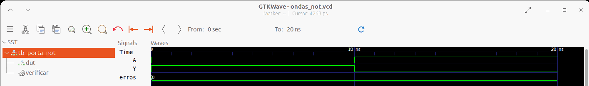

# Aula 03 — Porta lógica NOT em Verilog

## 1. Objetivo

Implementar a porta inversora (NOT) em Verilog HDL, construir um testbench auto-verificável e interpretar as formas de onda da simulação no GTKWave. A atividade dá continuidade às aulas de portas AND e OR.

**Estado:** simulação local aprovada em 25/10/2026, conforme saída do Icarus Verilog e captura real do GTKWave fornecidas durante a aula. A captura está publicada neste diretório.

## 2. Fundamentos

A porta NOT possui **uma entrada** e **uma saída**. Sua função é obter o complemento lógico da entrada:

**Y = NÃO(A) = ¬A**

| A | Y = NOT A |
|:-:|:---------:|
| 0 | 1 |
| 1 | 0 |

É um circuito **combinacional**, sem memória e sem sinal de clock.

No Verilog, o operador de inversão bit a bit é o til (`~`), como em `assign Y = ~A;`. Para sinais de um único bit bem definidos, o resultado coincide com a negação lógica `!A`, embora esses operadores difiram em vetores com mais de um bit.

## 3. Descrição do hardware — porta_not.v

~~~verilog
`timescale 1ns/1ps

// Aula 03 - Porta logica NOT: Y = ~A
module porta_not (
    input  wire A,
    output wire Y
);
    assign Y = ~A;
endmodule
~~~

- `module porta_not`: inicia a descrição de um componente digital.
- `input wire A`: entrada de um bit.
- `output wire Y`: saída de um bit.
- `assign Y = ~A;`: atribuição combinacional contínua; inverte A.
- `endmodule`: finaliza o módulo.
- `` `timescale 1ns/1ps ``: unidade temporal de 1 ns e precisão de 1 ps na simulação.

A declaração `wire` caracteriza uma rede dirigida pela atribuição contínua. O circuito não modela atraso físico de propagação.

## 4. Testbench — tb_porta_not.v

O arquivo [tb_porta_not.v](tb_porta_not.v) aplica os dois vetores da tabela-verdade e compara a saída com o resultado esperado. Ele **não** constitui a descrição sintetizável da porta.

### 4.1. Sinais e instância

~~~verilog
reg A;
wire Y;
integer erros;

porta_not dut (
    .A(A),
    .Y(Y)
);
~~~

A variável `reg A` recebe estímulos procedurais do testbench. Aqui, `reg` **não** implica um flip-flop físico. A instância `dut` (*Design Under Test*) conecta o módulo da porta à bancada de testes.

### 4.2. Tarefa de verificação

~~~verilog
task verificar;
    input a_teste;
    input y_esperado;
    begin
        A = a_teste;
        #10;
        if (Y !== y_esperado) begin
            $display("FALHA: A=%b | Y=%b (esperado=%b)", A, Y, y_esperado);
            erros = erros + 1;
        end else begin
            $display("OK: A=%b | Y=%b", A, Y);
        end
    end
endtask
~~~

- `task verificar`: evita repetir a lógica de teste para cada vetor.
- `A = a_teste`: define a entrada.
- `#10`: aguarda 10 ns de **tempo simulado** antes da comparação.
- `!==`: compara incluindo os estados `X` e `Z`, sinalizando falha se a saída não coincidir exatamente com o valor esperado.
- `erros`: contador de inconsistências.

No bloco `initial` são executadas as chamadas:

~~~verilog
verificar(1'b0, 1'b1);
verificar(1'b1, 1'b0);
~~~

A sintaxe `1'b0` denota um bit binário com valor 0. O testbench emite `PASS` quando os dois casos passam; caso contrário, utiliza `$fatal(1)` para encerrar com erro.

### 4.3. Registro da forma de onda

~~~verilog
$dumpfile("ondas_not.vcd");
$dumpvars(0, tb_porta_not);
~~~

Essas chamadas produzem o arquivo VCD (*Value Change Dump*) no diretório de trabalho do processo, permitindo observar `A`, `Y` e `erros` no GTKWave.

## 5. Como executar

Na **raiz do repositório**:

~~~bash
make test-not
make wave-not
~~~

Ou, entrando na pasta do exercício:

~~~bash
cd 01_Portas_Logicas/03_NOT
iverilog -Wall -s tb_porta_not -o porta_not.vvp porta_not.v tb_porta_not.v
vvp porta_not.vvp
gtkwave ondas_not.vcd
~~~

No Ubuntu, as ferramentas necessárias são instaladas com:

~~~bash
sudo apt update
sudo apt install iverilog gtkwave make
~~~

**Atenção aos caminhos:** os comandos dependem do diretório atual. Se o terminal já estiver na pasta `03_NOT`, não prefixe os nomes dos arquivos com `01_Portas_Logicas/03_NOT/`.

## 6. Resultado da simulação

A execução local fornecida na aula apresentou:

~~~text
VCD info: dumpfile ondas_not.vcd opened for output.
OK: A=0 | Y=1
OK: A=1 | Y=0
PASS: 2 de 2 combinacoes verificadas.
~~~

| Intervalo | A | Y | Interpretação |
|:--|:-:|:-:|:--|
| 0–10 ns | 0 | 1 | Entrada baixa, saída alta |
| 10–20 ns | 1 | 0 | Entrada alta, saída baixa |

O teste termina em **20 ns simulados**. O intervalo de 10 ns foi imposto pelo testbench e **não** corresponde à latência física de uma FPGA.

### 6.1. Evidência visual no GTKWave

A captura real do GTKWave confirma `A` e `Y` complementares no intervalo de 0 a 20 ns e o contador `erros = 0`.

*Figura 1 — Captura do GTKWave fornecida após a execução do testbench da Aula 03.*

## 7. Estrutura

~~~text
01_Portas_Logicas/
└── 03_NOT/
    ├── porta_not.v
    ├── tb_porta_not.v
    ├── README.md
    └── porta_not_gtkwave.png  # Captura real do GTKWave
~~~

Os arquivos `*.vvp` e `*.vcd` são gerados pela simulação e já estão ignorados pelo `.gitignore`.

## 8. Conclusão

A porta NOT foi descrita em Verilog e validada com **2/2 vetores corretos**, sem erros observados. A Aula 03 consolida os fundamentos de lógica combinacional e prepara a próxima atividade: **porta NAND**, que combina AND com inversão lógica.
