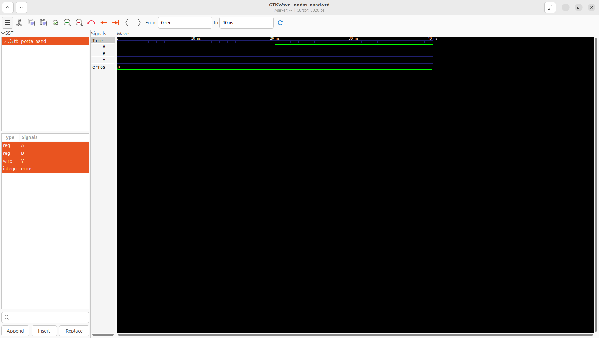

# Aula 04 — Porta lógica NAND em Verilog

## 1. Objetivo

Implementar uma porta NAND de duas entradas, construir um testbench auto-verificável e interpretar sua forma de onda no GTKWave. A aula combina as operações AND e NOT estudadas anteriormente.

**Estado:** simulação local aprovada em 26/10/2026, com **4/4 combinações corretas** e contador de erros igual a zero, conforme saída do Icarus Verilog e captura real do GTKWave fornecidas na aula. Trata-se de validação por simulação; não foi realizada implementação física em FPGA.

## 2. Fundamentos e tabela-verdade

NAND significa AND seguido de inversão: **Y = ¬(A · B)**. A saída vale **0 somente quando ambas as entradas valem 1**.

| A | B | A AND B | Y = NAND |
|:-:|:-:|:-:|:-:|
| 0 | 0 | 0 | 1 |
| 0 | 1 | 0 | 1 |
| 1 | 0 | 0 | 1 |
| 1 | 1 | 1 | 0 |

É um circuito combinacional, sem memória e sem clock.

### Por que a NAND é universal?

Portas NAND permitem construir NOT, AND e OR. Para entradas binárias:

| Função | Construção usando NAND |
|:--|:--|
| NOT A | NAND(A, A) |
| A AND B | T = NAND(A, B); Y = NAND(T, T) |
| A OR B | Y = NAND(NAND(A, A), NAND(B, B)) |

A construção de OR segue a lei de De Morgan: ¬(¬A · ¬B) = A + B. Essas construções são explicações teóricas; o módulo desta aula implementa apenas a NAND de duas entradas.

## 3. Descrição do hardware — porta_nand.v

~~~verilog
`timescale 1ns/1ps

// Aula 04 - Porta NAND
module porta_nand (
    input wire A,
    input wire B,
    output wire Y
);

    assign Y = ~(A & B);

endmodule
~~~

| Elemento | Significado |
|:--|:--|
| `module porta_nand` | Define o componente |
| `input wire A, B` | Duas entradas de um bit, declaradas separadamente no código |
| `output wire Y` | Saída dirigida pela atribuição contínua |
| `A & B` | AND bit a bit |
| `~(A & B)` | Inversão do resultado do AND |
| `assign` | Atualiza a saída quando suas entradas mudam |

Os parênteses deixam explícito que a inversão se aplica ao resultado do AND. Os operadores `&` e `~` atuam bit a bit; neste exercício os sinais têm um único bit.

A diretiva `` `timescale 1ns/1ps `` define unidade temporal de 1 ns e precisão de 1 ps para a simulação. O módulo não modela atraso físico de propagação.

## 4. Testbench — tb_porta_nand.v

O [testbench completo](tb_porta_nand.v) instancia a porta como `dut` (*Design Under Test*), aplica as quatro combinações binárias e compara a saída com valores esperados explícitos.

### Sinais e conexões

- `reg A` e `reg B`: recebem os estímulos procedurais. O uso de `reg` no testbench não implica flip-flops físicos.
- `wire Y`: recebe a saída da porta.
- `integer erros`: conta as divergências.
- `.A(A)`, `.B(B)` e `.Y(Y)`: conectam as portas do módulo aos sinais da bancada.

### Tarefa verificar

A tarefa recebe `a_teste`, `b_teste` e `y_esperado`, atribui as entradas, aguarda `#10` e confere `Y`.

~~~verilog
verificar(1'b0, 1'b0, 1'b1);
verificar(1'b0, 1'b1, 1'b1);
verificar(1'b1, 1'b0, 1'b1);
verificar(1'b1, 1'b1, 1'b0);
~~~

Cada literal `1'b0` ou `1'b1` representa um bit binário. O operador `!==` compara incluindo os estados desconhecido (`X`) e alta impedância (`Z`); uma saída nesses estados falha quando o esperado é 0 ou 1. As quatro combinações de entradas binárias estão cobertas; entradas X/Z não são vetores adicionais deste teste.

Se houver divergência, o contador aumenta e `$fatal(1)` encerra a simulação com erro. Se todos os casos passarem, o testbench imprime `PASS` e termina normalmente com `$finish`.

### Registro das ondas

~~~verilog
$dumpfile("ondas_nand.vcd");
$dumpvars(0, tb_porta_nand);
~~~

O arquivo VCD registra mudanças nos sinais e é criado **na pasta de onde o processo `vvp` é executado**.

## 5. Executar a partir da raiz do repositório

~~~bash
cd "$(git rev-parse --show-toplevel)"
make test-nand
make wave-nand
~~~

`make wave-nand` executa o teste antes de abrir o GTKWave. Para verificar todas as aulas:

~~~bash
make test
~~~

São **14 vetores binários**: AND (4), OR (4), NOT (2) e NAND (4).

A sequência manual equivalente, na raiz, é:

~~~bash
mkdir -p build
iverilog -Wall -s tb_porta_nand \
  -o build/porta_nand.vvp \
  01_Portas_Logicas/04_NAND/porta_nand.v \
  01_Portas_Logicas/04_NAND/tb_porta_nand.v
vvp build/porta_nand.vvp
gtkwave ondas_nand.vcd
~~~

## 6. Executar dentro da pasta 04_NAND

~~~bash
cd 01_Portas_Logicas/04_NAND
mkdir -p build
iverilog -Wall -s tb_porta_nand \
  -o build/porta_nand.vvp \
  porta_nand.v tb_porta_nand.v
vvp build/porta_nand.vvp
gtkwave ondas_nand.vcd
~~~

Escolha um dos diretórios de execução e mantenha os caminhos correspondentes.

| Comando | Resultado |
|:--|:--|
| `iverilog` | Compila os fontes e produz o arquivo .vvp |
| `vvp` | Executa a simulação e produz o VCD configurado |
| `gtkwave` | Abre o VCD existente para inspeção |

### Dificuldades observadas durante a aula

- **No such file or directory:** os caminhos eram relativos à raiz, mas o terminal estava em uma subpasta. Dentro de `04_NAND`, use apenas `porta_nand.v` e `tb_porta_nand.v`.
- **Unable to find the root module:** neste caso foi consequência de os fontes não terem sido encontrados; o nome `tb_porta_nand` estava correto.
- **GTKWave não encontra o VCD:** compilar não executa o testbench. Execute `vvp` e abra o VCD na pasta onde a simulação foi executada.
- **Caracteres como ^[[200~ ao colar:** a linha recebida continha caracteres extras. Cancelar a linha e redigitar o comando resolveu o problema; `vvp` já estava instalado.

Para criar arquivos vazios dentro de `01_Portas_Logicas`:

~~~bash
mkdir -p 04_NAND
touch 04_NAND/porta_nand.v 04_NAND/tb_porta_nand.v
~~~

## 7. Resultado da simulação

A execução local enviada durante a aula apresentou:

~~~text
VCD info: dumpfile ondas_nand.vcd opened for output.
OK: A=0 B=0 | Y=1
OK: A=0 B=1 | Y=1
OK: A=1 B=0 | Y=1
OK: A=1 B=1 | Y=0
PASS: 4 de 4 combinacoes verificadas.
~~~

A mensagem `$finish called at 40000 (1ps)` indica encerramento normal em **40.000 ps = 40 ns**.

| Intervalo | A | B | Y | Interpretação |
|:--|:-:|:-:|:-:|:--|
| 0–10 ns | 0 | 0 | 1 | AND = 0; inversão = 1 |
| 10–20 ns | 0 | 1 | 1 | AND = 0; inversão = 1 |
| 20–30 ns | 1 | 0 | 1 | AND = 0; inversão = 1 |
| 30–40 ns | 1 | 1 | 0 | AND = 1; inversão = 0 |

O `#10` organiza os estímulos no tempo simulado; não mede latência física da FPGA. Não há clock no circuito.

## 8. Captura real do GTKWave

*Figura 1 — Captura fornecida após a execução local em 26/10/2026.*

A captura mostra os sinais `A`, `B`, `Y` e o contador `erros = 0`. Aos 20 ns as entradas trocam de estado e Y permanece em 1. Aos 30 ns, ambas ficam em 1 e Y passa para 0.

Para reproduzir a visualização, selecione `tb_porta_nand`, adicione A, B e Y e utilize **Zoom Fit** para mostrar os 40 ns.

## 9. Arquivos e próximos estudos

- [porta_nand.v](porta_nand.v): descrição da porta.
- [tb_porta_nand.v](tb_porta_nand.v): bancada de testes.
- [porta_nand_gtkwave.png](porta_nand_gtkwave.png): evidência da simulação.
- README.md: teoria, execução e análise.

Arquivos `*.vvp`, `*.vcd` e pastas `build/` são artefatos gerados e estão ignorados pelo Git.

A próxima aula aborda a **porta NOR**, que combina OR com inversão e também é universal.
