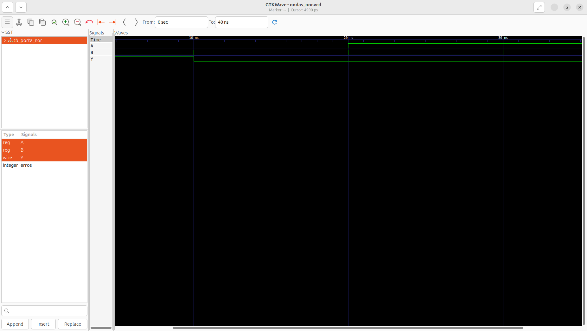

# Aula 05 — Porta lógica NOR em Verilog

## 1. Objetivo

Implementar uma porta NOR de duas entradas, desenvolver um testbench auto-verificável e analisar sua forma de onda no GTKWave.

**Estado:** simulação local aprovada em 26/10/2026, com **4/4 combinações corretas**, conforme a saída do Icarus Verilog e a captura real do GTKWave. Trata-se de validação por simulação; não foi realizada implementação física em FPGA.

## 2. Fundamentos da porta NOR

A porta NOR corresponde à negação da operação OR:

**Y = ¬(A + B)**

A saída vale 1 somente quando todas as entradas valem 0.

| A | B | A OR B | Y = NOR |
|:-:|:-:|:-:|:-:|
| 0 | 0 | 0 | 1 |
| 0 | 1 | 1 | 0 |
| 1 | 0 | 1 | 0 |
| 1 | 1 | 1 | 0 |

A NOR é uma porta universal, pois permite construir qualquer função lógica combinacional.

## 3. Descrição do hardware — porta_nor.v

~~~verilog
`timescale 1ns/1ps

// ==========================================================
// Aula 05 - Porta NOR
//
// A saída Y será igual a 1 somente quando A e B forem 0.
//
// Equação lógica:
// Y = ~(A | B)
// ==========================================================

module porta_nor (
    input  wire A,
    input  wire B,
    output wire Y
);

    assign Y = ~(A | B);

endmodule
~~~

A atribuição contínua:

~~~verilog
assign Y = ~(A | B);
~~~

primeiro realiza a operação OR bit a bit e depois inverte o resultado. Como o circuito é combinacional, qualquer alteração em A ou B atualiza a saída Y.

A diretiva `timescale 1ns/1ps define unidade temporal de 1 ns e precisão de 1 ps apenas para a simulação. O módulo não modela atraso físico de propagação.

## 4. Testbench — tb_porta_nor.v

O [testbench completo](tb_porta_nor.v) instancia o módulo como DUT (*Device Under Test*), aplica as quatro combinações possíveis e compara a saída com o resultado esperado.

A tarefa verificar recebe três valores:

1. entrada A;
2. entrada B;
3. saída Y esperada.

~~~verilog
verificar(1'b0, 1'b0, 1'b1);
verificar(1'b0, 1'b1, 1'b0);
verificar(1'b1, 1'b0, 1'b0);
verificar(1'b1, 1'b1, 1'b0);
~~~

O operador !== também detecta valores desconhecidos X e alta impedância Z. Se houver uma divergência, o contador erros é incrementado e a simulação termina com falha. Caso contrário, é exibida a mensagem PASS.

### Registro das formas de onda

~~~verilog
$dumpfile("ondas_nor.vcd");
$dumpvars(0, tb_porta_nor);
~~~

O arquivo VCD é criado no diretório de onde o processo vvp é executado.

## 5. Executar a partir da raiz do repositório

~~~bash
cd "$(git rev-parse --show-toplevel)"
make test-nor
make wave-nor
~~~

Para executar todas as aulas:

~~~bash
make test
~~~

A suíte completa contém **18 vetores binários**: AND (4), OR (4), NOT (2), NAND (4) e NOR (4).

A sequência manual equivalente é:

~~~bash
mkdir -p build
iverilog -Wall -s tb_porta_nor \
  -o build/porta_nor.vvp \
  01_Portas_Logicas/05_NOR/porta_nor.v \
  01_Portas_Logicas/05_NOR/tb_porta_nor.v
vvp build/porta_nor.vvp
gtkwave ondas_nor.vcd
~~~

## 6. Executar dentro da pasta 05_NOR

~~~bash
cd 01_Portas_Logicas/05_NOR
mkdir -p build
iverilog -Wall -s tb_porta_nor \
  -o build/nor.vvp \
  porta_nor.v tb_porta_nor.v
vvp build/nor.vvp
gtkwave ondas_nor.vcd
~~~

## 7. Resultado da simulação

A execução local apresentou:

~~~text
VCD info: dumpfile ondas_nor.vcd opened for output.
================================
 Teste da porta NOR
================================
OK:   A=0 B=0 | Y=1
OK:   A=0 B=1 | Y=0
OK:   A=1 B=0 | Y=0
OK:   A=1 B=1 | Y=0
================================
PASS: todos os testes passaram.
~~~

A mensagem $finish called at 40000 (1ps) indica encerramento normal em **40.000 ps = 40 ns**.

| Intervalo | A | B | Y | Interpretação |
|:--|:-:|:-:|:-:|:--|
| 0–10 ns | 0 | 0 | 1 | OR = 0; inversão = 1 |
| 10–20 ns | 0 | 1 | 0 | OR = 1; inversão = 0 |
| 20–30 ns | 1 | 0 | 0 | OR = 1; inversão = 0 |
| 30–40 ns | 1 | 1 | 0 | OR = 1; inversão = 0 |

O atraso #10 organiza os estímulos no tempo simulado; não mede latência física da FPGA.

## 8. Captura real do GTKWave

*Figura 1 — Captura fornecida após a execução local em 26/10/2026.*

A captura confirma que Y permanece em nível alto apenas no primeiro intervalo, quando A=0 e B=0. Nas outras três combinações, Y permanece em nível baixo.

## 9. Arquivos

- [porta_nor.v](porta_nor.v): descrição da porta NOR.
- [tb_porta_nor.v](tb_porta_nor.v): bancada de testes.
- [porta_nor_gtkwave.png](porta_nor_gtkwave.png): evidência da simulação.
- README.md: teoria, execução e análise.

Arquivos .vvp, .vcd e diretórios build/ são artefatos gerados e permanecem ignorados pelo Git.

## 10. Conclusão

A porta NOR foi implementada e validada corretamente. A aula reforça circuitos combinacionais, operadores bit a bit, atribuição contínua, testes automatizados, arquivos VCD e inspeção de formas de onda.

A próxima aula aborda a **porta XOR**, cuja saída vale 1 quando as entradas são diferentes.
