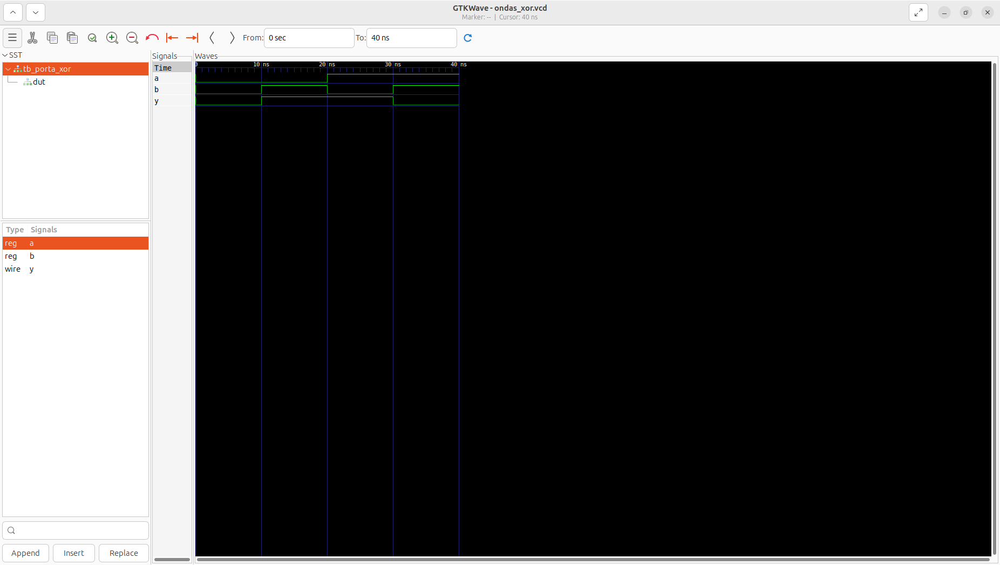

# Aula 06 — Porta lógica XOR em Verilog

## 1. Objetivo

Implementar uma porta XOR de duas entradas, desenvolver um testbench auto-verificável e analisar sua forma de onda no GTKWave.

**Estado:** simulação local aprovada em 28/10/2026, com **4/4 combinações corretas**, conforme a saída do Icarus Verilog e a captura real do GTKWave. Trata-se de validação por simulação; não foi realizada implementação física em FPGA.

## 2. Fundamentos da porta XOR

XOR significa *Exclusive OR* ou **OU exclusivo**. Sua saída vale 1 quando as entradas são diferentes:

**Y = A ⊕ B = A̅B + AB̅**

| A | B | Y = A XOR B |
|:-:|:-:|:-:|
| 0 | 0 | 0 |
| 0 | 1 | 1 |
| 1 | 0 | 1 |
| 1 | 1 | 0 |

Diferentemente da porta OR, a XOR produz 0 quando as duas entradas são 1. Ela é útil em somadores binários, detectores de diferença, circuitos de paridade e comparadores.

## 3. Descrição do hardware — porta_xor.v

~~~verilog
`timescale 1ns/1ps

module porta_xor (
    input  wire a,
    input  wire b,
    output wire y
);

    assign y = a ^ b;

endmodule
~~~

O operador `^` realiza XOR bit a bit. Como a atribuição é contínua, qualquer mudança em `a` ou `b` atualiza imediatamente `y` no modelo combinacional.

A diretiva de escala temporal (`timescale 1ns/1ps`) define unidade de 1 ns e precisão de 1 ps apenas para a simulação; ela não representa o atraso físico de uma FPGA.

## 4. Testbench — tb_porta_xor.v

O [testbench completo](tb_porta_xor.v) instancia o DUT, aplica as quatro combinações possíveis e compara `y` com o valor esperado:

~~~verilog
verificar(1'b0, 1'b0, 1'b0);
verificar(1'b0, 1'b1, 1'b1);
verificar(1'b1, 1'b0, 1'b1);
verificar(1'b1, 1'b1, 1'b0);
~~~

O operador `!==` também detecta valores desconhecidos X e alta impedância Z. Uma divergência incrementa o contador de erros e faz o teste terminar com falha; com todas as combinações corretas, é exibido `PASS`.

As instruções abaixo geram o arquivo de formas de onda:

~~~verilog
$dumpfile("ondas_xor.vcd");
$dumpvars(0, tb_porta_xor);
~~~

## 5. Executar a partir da raiz do repositório

~~~bash
cd "$(git rev-parse --show-toplevel)"
make test-xor
make wave-xor
~~~

Para executar todas as aulas:

~~~bash
make test
~~~

A suíte completa contém **22 vetores binários**: AND (4), OR (4), NOT (2), NAND (4), NOR (4) e XOR (4).

## 6. Resultado da simulação

A execução local confirmou:

~~~text
VCD info: dumpfile ondas_xor.vcd opened for output.
================================
 Teste da porta XOR
================================
OK:   A=0 B=0 | Y=0
OK:   A=0 B=1 | Y=1
OK:   A=1 B=0 | Y=1
OK:   A=1 B=1 | Y=0
================================
PASS: todos os testes passaram.
~~~

| Intervalo | A | B | Y | Interpretação |
|:--|:-:|:-:|:-:|:--|
| 0–10 ns | 0 | 0 | 0 | Entradas iguais |
| 10–20 ns | 0 | 1 | 1 | Entradas diferentes |
| 20–30 ns | 1 | 0 | 1 | Entradas diferentes |
| 30–40 ns | 1 | 1 | 0 | Entradas iguais |

Os intervalos de 10 ns apenas organizam os estímulos no tempo simulado; não medem latência física.

## 7. Comparação entre XOR, OR e AND

| A | B | AND | OR | XOR |
|:-:|:-:|:-:|:-:|:-:|
| 0 | 0 | 0 | 0 | 0 |
| 0 | 1 | 0 | 1 | 1 |
| 1 | 0 | 0 | 1 | 1 |
| 1 | 1 | 1 | 1 | 0 |

A diferença decisiva aparece em A=1 e B=1: OR produz 1, enquanto XOR produz 0.

## 8. Captura real do GTKWave

*Figura 1 — Captura fornecida após a execução local em 28/10/2026.*

A captura confirma que `y` permanece em nível alto somente nos intervalos em que A e B são diferentes.

## 9. Arquivos

- [porta_xor.v](porta_xor.v): descrição da porta XOR.
- [tb_porta_xor.v](tb_porta_xor.v): testbench auto-verificável.
- [porta_xor_gtkwave.png](porta_xor_gtkwave.png): evidência da simulação.
- README.md: teoria, execução e análise.

Arquivos `.vvp`, `.vcd` e diretórios `build/` são artefatos gerados e permanecem ignorados pelo Git.

## 10. Conclusão

A porta XOR foi implementada e validada corretamente nas quatro combinações possíveis. A aula reforça lógica combinacional, atribuição contínua, testes automatizados, arquivos VCD e inspeção de formas de onda.

A próxima aula aborda a **porta XNOR**, cuja saída vale 1 quando as entradas são iguais.
