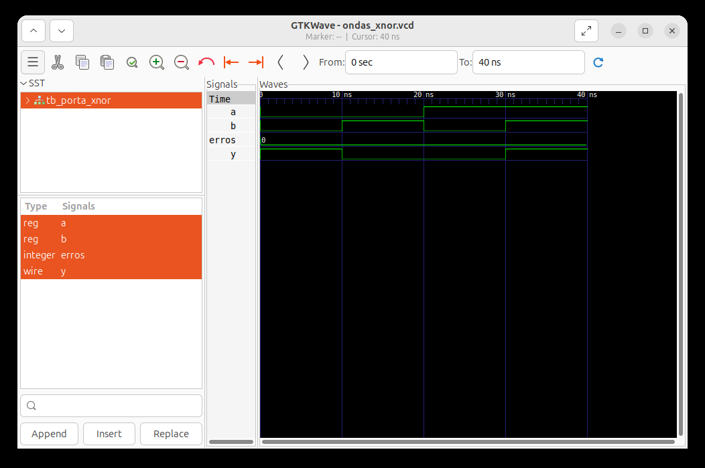

# Aula 07 — Porta lógica XNOR em Verilog

## 1. Objetivo

Implementar uma porta XNOR de duas entradas, verificar todas as combinações binárias e analisar as formas de onda no GTKWave.

**Estado:** simulação local do aluno aprovada em 28/10/2026, com **4/4 combinações corretas** e zero erros, conforme o terminal e a captura real fornecidos. A validação desta aula é por simulação; não foi realizada implementação física em FPGA.

## 2. Fundamentos e tabela-verdade

A XNOR inverte o resultado da XOR. Para duas entradas binárias, sua saída vale 1 quando as entradas são iguais:

**Y = ¬(A ⊕ B) = AB + A̅B̅**

| A | B | XOR | XNOR |
|:-:|:-:|:-:|:-:|
| 0 | 0 | 0 | 1 |
| 0 | 1 | 1 | 0 |
| 1 | 0 | 1 | 0 |
| 1 | 1 | 0 | 1 |

A XOR detecta diferença entre dois bits; a XNOR detecta igualdade. Com B=0, Y=¬A; com B=1, Y=A.

Para comparar palavras de vários bits, a XNOR bit a bit produz um vetor de correspondências. A igualdade da palavra inteira exige que todos esses bits sejam 1, por exemplo, com uma redução AND: `&(a ~^ b)`. A redução XNOR `~^a` tem um único operando e verifica paridade, não igualdade entre palavras.

## 3. Descrição do hardware

Arquivo: [porta_xnor.v](porta_xnor.v).

~~~verilog
`timescale 1ns/1ps

module porta_xnor (
    input  wire a,
    input  wire b,
    output wire y
);

    assign y = ~(a ^ b);

endmodule
~~~

O operador `^` realiza XOR bit a bit e `~` inverte o resultado. A expressão equivalente de dois operandos é `a ~^ b`. A atribuição contínua descreve lógica combinacional, sem clock ou armazenamento.

A diretiva `timescale 1ns/1ps` define unidade e precisão para a simulação; não mede o atraso físico de uma FPGA.

## 4. Testbench auto-verificável

O [testbench completo](tb_porta_xnor.v) instancia o DUT, aplica os quatro vetores e compara cada resultado com a tabela-verdade:

~~~verilog
verificar(1'b0, 1'b0, 1'b1);
verificar(1'b0, 1'b1, 1'b0);
verificar(1'b1, 1'b0, 1'b0);
verificar(1'b1, 1'b1, 1'b1);
~~~

Cada teste aguarda 10 ns antes da conferência. O operador `!==` considera também X e Z na comparação com a saída binária esperada. Ao encontrar divergências, o teste contabiliza erros e termina com `$fatal(1, ...)`, sinalizando falha à automação. Caso contrário, imprime PASS.

O arquivo de ondas é gerado por:

~~~verilog
$dumpfile("ondas_xnor.vcd");
$dumpvars(0, tb_porta_xnor);
~~~

## 5. Executar a partir da raiz do repositório

No terminal, dentro de qualquer pasta deste repositório:

~~~bash
cd "$(git rev-parse --show-toplevel)"
make test-xnor
make wave-xnor
~~~

Para executar todas as aulas:

~~~bash
make test
~~~

A suíte contém **26 vetores binários**: AND (4), OR (4), NOT (2), NAND (4), NOR (4), XOR (4) e XNOR (4). O GitHub Actions executa o mesmo alvo `make test`.

Alternativa manual, também a partir da raiz:

~~~bash
mkdir -p build
iverilog -Wall -s tb_porta_xnor \
  -o build/porta_xnor.vvp \
  01_Portas_Logicas/07_XNOR/porta_xnor.v \
  01_Portas_Logicas/07_XNOR/tb_porta_xnor.v
vvp build/porta_xnor.vvp
gtkwave ondas_xnor.vcd
~~~

## 6. Resultado observado

A execução local fornecida pelo aluno confirmou:

~~~text
VCD info: dumpfile ondas_xnor.vcd opened for output.
================================
 Teste da porta XNOR
================================
OK:   A=0 B=0 | Y=1
OK:   A=0 B=1 | Y=0
OK:   A=1 B=0 | Y=0
OK:   A=1 B=1 | Y=1
================================
PASS: todos os testes passaram.
~~~

O término em 40000 unidades de 1 ps corresponde a **40 ns**. A mensagem de `$finish` indica o encerramento normal da simulação.

## 7. Captura real do GTKWave

*Figura 1 — Captura fornecida pelo aluno após a execução local em 28/10/2026. A janela identifica ondas_xnor.vcd e tb_porta_xnor; o arquivo recebido foi nomeado como XOR, mas seu conteúdo corresponde à XNOR.*

| Intervalo | A | B | Y | Interpretação |
|:--|:-:|:-:|:-:|:--|
| 0–10 ns | 0 | 0 | 1 | Entradas iguais |
| 10–20 ns | 0 | 1 | 0 | Entradas diferentes |
| 20–30 ns | 1 | 0 | 0 | Entradas diferentes |
| 30–40 ns | 1 | 1 | 1 | Entradas iguais |

A saída segue **1, 0, 0, 1**, e o contador `erros` permanece em zero. Em 20 ns, as duas entradas trocam de valor e continuam diferentes, portanto Y permanece em 0 após a atualização combinacional.

Os intervalos de 10 ns organizam os estímulos e não representam atrasos físicos.

## 8. Cuidados com nomes e caminhos

- O comando para mudar de pasta é `cd`, em minúsculas.
- O testbench deve se chamar `tb_porta_xnor.v`, incluindo a extensão completa.
- Os caminhos dos comandos são relativos à pasta atual. Os comandos desta documentação partem da raiz do repositório.
- Execute o `vvp` somente após a compilação bem-sucedida. Erros de arquivo ausente não indicam defeito na lógica da porta.

## 9. Arquivos e continuidade

- [porta_xnor.v](porta_xnor.v): implementação.
- [tb_porta_xnor.v](tb_porta_xnor.v): verificação das quatro combinações.
- [porta_xnor_gtkwave.png](porta_xnor_gtkwave.png): evidência real da simulação.
- README.md: teoria, comandos e análise dos resultados.

Arquivos `.vvp`, `.vcd` e diretórios `build/` são gerados localmente e permanecem ignorados pelo Git.

A próxima etapa da trilha é o **multiplexador 2:1**, que seleciona uma de duas entradas por meio de um sinal de controle.
