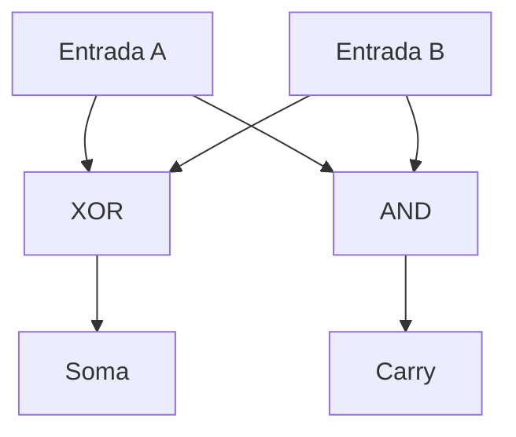

# Aula 08 — Meio somador (half adder)

**Situação:** código e testbench preparados. A execução pelo aluno e a captura
do GTKWave ainda devem ser registradas. Esta aula inicia o Módulo 02.

## 1. Objetivo

Somar dois bits usando as portas XOR e AND que já estudamos. O circuito tem
entradas `a` e `b` e saídas `soma` e `carry` (o “vai um”). Não há clock.

| A | B | Soma decimal | Carry | Soma | Resultado binário `{carry, soma}` |
|:--:|:--:|:--:|:--:|:--:|:--:|
| 0 | 0 | 0 | 0 | 0 | 00 |
| 0 | 1 | 1 | 0 | 1 | 01 |
| 1 | 0 | 1 | 0 | 1 | 01 |
| 1 | 1 | 2 | 1 | 0 | 10 |

Em binário, **1 + 1 = 10**: o bit menos significativo é 0 e o carry é 1.
Com os dois bits de saída, o valor 2 é representado corretamente. O carry
neste circuito sem sinal não deve ser confundido com overflow em aritmética
com sinal.

As expressões são `soma = a ^ b` e `carry = a & b`.



## 2. Entender o módulo

Abra [meio_somador.v](meio_somador.v). `input wire` declara os sinais de entrada
e `output wire`, os de saída. Cada `assign` descreve uma relação combinacional
contínua. As duas saídas são calculadas concorrentemente.

Os operadores `^` e `&` atuam bit a bit. Como as entradas têm um bit, eles
implementam diretamente XOR e AND. O módulo é uma descrição RTL sintetizável;
a síntese e a implementação em uma FPGA ainda não foram realizadas.

Chamamos esse circuito de **meio somador** porque ele não recebe carry de uma
posição anterior. Na Aula 09, o somador completo terá uma terceira entrada,
`carry_in`, e permitirá encadear posições binárias.

## 3. Entender o testbench

Abra [tb_meio_somador.v](tb_meio_somador.v).

- `dut` é a instância do circuito sob teste.
- `a` e `b` são `reg` porque recebem valores no bloco `initial` do testbench.
  Isso não significa que o meio somador contém registradores físicos.
- O laço percorre `00`, `01`, `10` e `11`, cobrindo todas as combinações binárias.
- `{a, b}` concatena os dois bits; `vetor[1:0]` seleciona os dois bits inferiores
  do contador do laço.
- A referência `{1'b0, a} + {1'b0, b}` estende cada entrada para dois bits antes
  de somar. Assim o resultado 2 não perde o carry por falta de largura.
- `{carry, soma}` coloca o carry no bit mais significativo do resultado.
- `!==` também detecta valores desconhecidos `x` ou de alta impedância `z` na
  saída. As entradas testadas, porém, são somente os quatro casos binários.
- `$fatal(1, ...)` faz a execução falhar se houver divergência, permitindo que
  o GitHub Actions detecte o erro.
- `$dumpfile` e `$dumpvars` geram o arquivo VCD para inspeção no GTKWave.

O intervalo `#10` separa os estímulos por 10 ns de tempo simulado. Ele não
mede atraso físico de portas, latência ou frequência máxima de uma FPGA.

## 4. Prática no VS Code

Na raiz do seu clone local, com as alterações locais já salvas em commit,
sincronize a versão publicada:

```bash
git status
git pull --ff-only
code .
make test-meio-somador
make wave-meio-somador
```

Se `git status` mostrar alterações não salvas em commit, revise-as antes do
`git pull`. O comando `make` cria a pasta `build` e executa:

```bash
iverilog -Wall -s tb_meio_somador -o build/meio_somador.vvp \
  02_Circuitos_Combinacionais/01_Meio_Somador/meio_somador.v \
  02_Circuitos_Combinacionais/01_Meio_Somador/tb_meio_somador.v
vvp build/meio_somador.vvp
```

A saída esperada é:

```text
OK: A=0 B=0 CARRY=0 SOMA=0
OK: A=0 B=1 CARRY=0 SOMA=1
OK: A=1 B=0 CARRY=0 SOMA=1
OK: A=1 B=1 CARRY=1 SOMA=0
PASS: meio somador, 4/4 combinacoes binarias.
```

No GTKWave, adicione `a`, `b`, `soma` e `carry` e use **Zoom Fit**.

| Intervalo simulado | A | B | Soma | Carry |
|:--|:--:|:--:|:--:|:--:|
| 0 a 10 ns | 0 | 0 | 0 | 0 |
| 10 a 20 ns | 0 | 1 | 1 | 0 |
| 20 a 30 ns | 1 | 0 | 1 | 0 |
| 30 a 40 ns | 1 | 1 | 0 | 1 |

Essa tabela descreve os valores estabilizados em cada intervalo. Salve uma
captura real como `meio_somador_gtkwave.png` nesta pasta e registre sua análise.
A captura ainda não faz parte desta entrega.

Para executar a trilha inteira, use `make test`: **26 casos das portas +
4 do meio somador = 30 vetores binários**.

## 5. Exercícios resolvidos

**Por que OR não serve como bit de soma?** Para A=B=1, OR retorna 1. O bit de
soma correto é 0, acompanhado de carry=1. XOR produz o bit de soma correto.

**Quanto vale `{carry, soma}` quando A=1 e B=0?** `01`, ou 1 em decimal.

**O circuito precisa de reset?** Não. Ele não guarda estado: as saídas são
determinadas pelas entradas atuais, respeitado o atraso físico do hardware.

## 6. Exercícios para realizar

1. Preveja a sequência das duas saídas antes de executar a simulação.
2. Explique por que são necessários dois bits para representar todos os resultados.
3. Em uma cópia local, substitua XOR por OR e execute o teste. Identifique a
   combinação que falha e restaure o código correto antes de fazer commit.
4. Explique qual entrada falta para somar três bits. Essa é a ponte para a Aula 09.
